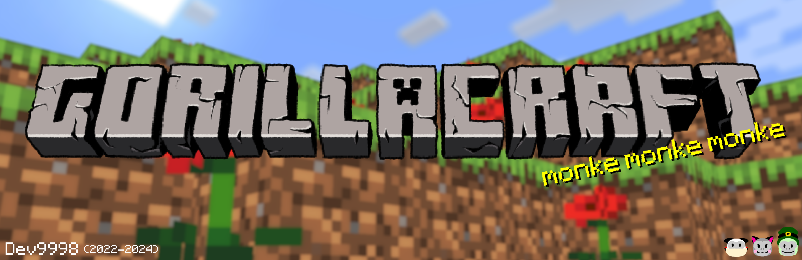
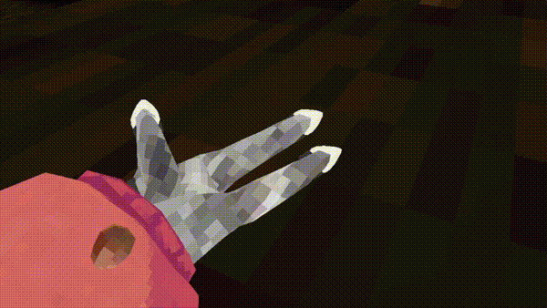
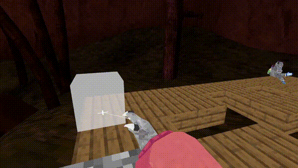

# 🦍 GorillaCraft

*GorillaCraft* is a mod for **Gorilla Tag** that brings creative-mode-inspired mechanics into the game, including a selection of solid and decorative blocks that are shared amongst players within a room.

## ✨ Features

- 🧱 **Solid Blocks** – Place blocks to build your own structures.
- 🎨 **Decorative Blocks** – Add detail and personality to your creations.
- 🌍 **Shared Building** – Creations and blocks are shared amongst players within a room.
- 🏠 **Creative Building** – Build houses, structures and whatever else you can imagine.
- 🎮 **Quest Support** – Designed for Meta Quest players.
- ⚡ **In-Game Building** – Bring creative-mode-inspired building into Gorilla Tag.

## 📥 Installation

1. Download the latest GorillaCraft release.
2. Extract the downloaded `.zip` file.
3. Follow the included installation instructions.
4. Install the GorillaCraft APK.
5. Launch Gorilla Tag and enjoy building!

## 📸 Screenshots & Gameplay

Take a look at what you can create with GorillaCraft!

### 🧱 Block Showcase

### 🏠 House Building

## ⚠️ Disclaimer

This product is not affiliated with Another Axiom Inc. or its videogames Gorilla Tag and Orion Drift and is not endorsed or otherwise sponsored by Another Axiom.

Portions of the materials contained herein are property of Another Axiom.

©2021 Another Axiom Inc.

## 🔧 Compatibility

- **Platform:** Meta Quest
- **Project:** GorillaCraft
- **Game:** Gorilla Tag
- **Type:** Gorilla Tag Mod

## 📋 Updates

Check the [Releases](recrewind/gorillacraft/releases) page for the latest versions, updates and improvements.

## ⭐ Support & Community

Join the community or support development!

- [Discord](https://discord.gg/questmods)
- Support Me @ [Ko-Fi](https://ko-fi.com/nkhhi)

---
